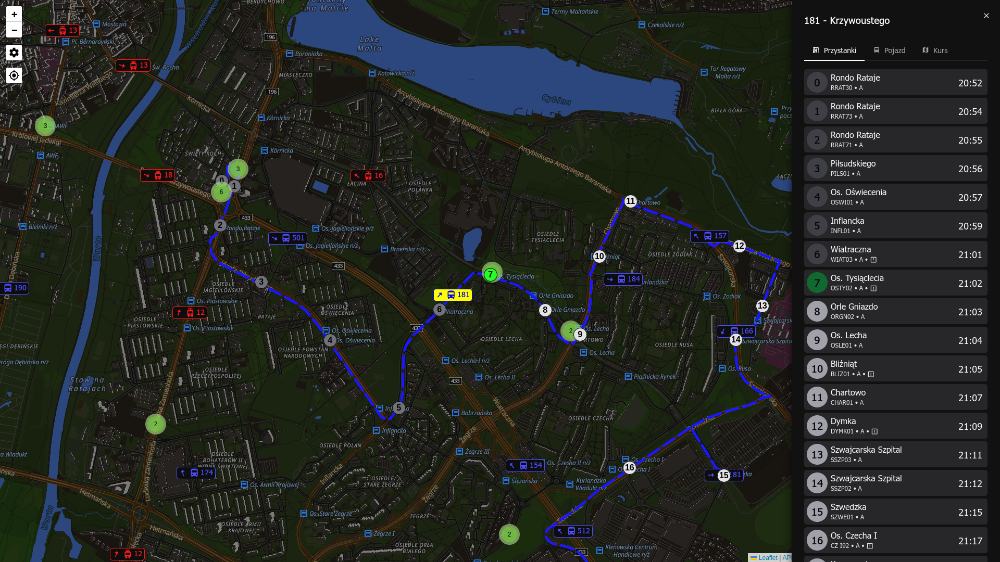
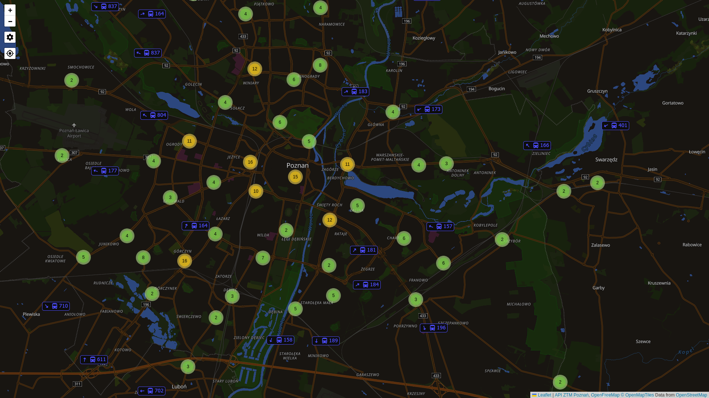
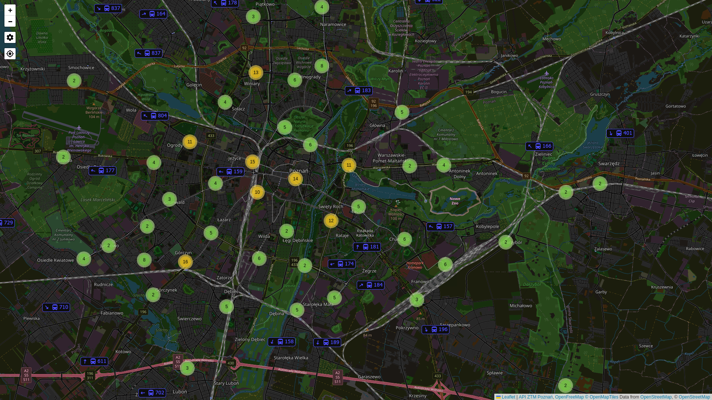
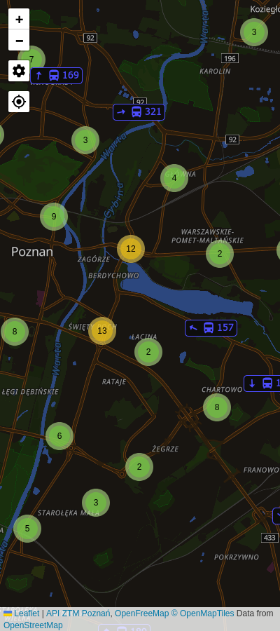
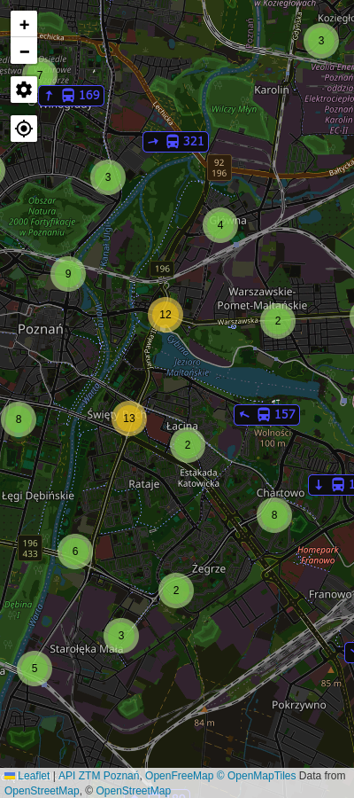
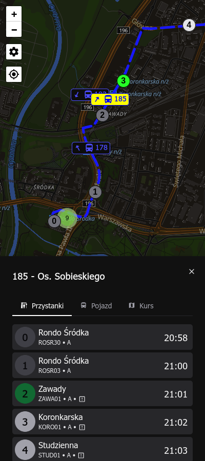

# 🚊🗺️ Mapa ZTM

Nieoficjalna mapa pojazdów ZTM Poznań



> [!NOTE]
> English README and documentation are not yet available. \
> The application currently supports only Polish.

## ℹ️ O projekcie

Aplikacja webowa do śledzenia na żywo pojazdów komunikacji miejskiej w Poznaniu i okolicach. \
Wykorzystuje dane **GTFS Realtime** oraz **GTFS Schedule** udostępniane przez **Zarząd Transportu Miejskiego w Poznaniu**.

Wyświetlane są dane dotyczące pojazdów kursujących na terenie Poznania (transport realizowany przez Miejskie Przedsiębiorstwo Komunikacyjne w Poznaniu) oraz okolicznych gmin, które przesyłają dane do ZTM (m.in. Swarzędz, Luboń, Komorniki, Suchy Las).

## 📱 Zrzuty ekranu

<details>
<summary>Kliknij, aby pokazać</summary>

### Urządzenie desktopowe



Główny widok aplikacji



Główny widok aplikacji (alternatywny styl mapy)


Śledzenie pojazdu na mapie

### Urządzenie mobilne



Główny widok aplikacji



Główny widok aplikacji (alternatywny styl mapy)



Śledzenie pojazdu na mapie

</details>

## ✨ Funkcje (dostępne i planowane)

- [x] Wyświetlanie pojazdów na mapie w czasie rzeczywistym
- [x] Wyświetlanie szczegółów kursów i pojazdów (przebieg trasy, przystanki, itp.)
- [x] Progresywna Aplikacja Webowa (PWA)
- [ ] Lokalizacje wszystkich przystanków
- [ ] Szczegóły przystanków (linie, najbliższe odjazdy)
- [ ] Lokalizacje punktów sprzedaży biletów
- [ ] Rozkłady jazdy dla dowolnych linii i przystanków
- [ ] Wyszukiwarka (linie, pojazdy, kursy i przystanki)

## ⚠️ Zastrzeżenie

Projekt ma charakter hobbystyczny i jest rozwijany w wolnym czasie. Używane przez aplikację dane GTFS pochodzą z zewnętrznego źródła, więc mogą być opóźnione, niedokładne lub chwilowo nieprawidłowe. **Nie należy używać aplikacji do podejmowania żadnych krytycznych działań**.

Projekt oraz autor aplikacji nie są w żaden sposób powiązani z Zarządem Transportu Miejskiego w Poznaniu, Miejskim Przedsiębiorstwem Komunikacyjnym w Poznaniu ani innymi operatorami transportu publicznego.

## ⚙️ Źródła danych i użyte technologie

**Dane GTFS (Realtime i Schedule):** [API ZTM Poznań](https://www.ztm.poznan.pl/otwarte-dane/dla-deweloperow/) \
**Mapy:** [OpenFreeMap](https://openfreemap.org/), [OpenStreetMap](https://www.openstreetmap.org/) \
**Frontend:** [Leaflet](https://leafletjs.com/), [Chakra UI](https://www.chakra-ui.com/), [React](https://react.dev/), [Vite](https://vite.dev/) \
**Backend:** [FastAPI](https://fastapi.tiangolo.com/), [gtfs-realtime-bindings](https://github.com/MobilityData/gtfs-realtime-bindings)

## 🛠️ Uruchomienie lokalne

### Docker (prosty przykład)

```bash
docker run --rm -p 8000:8000 ghcr.io/bartekl1/mapa-ztm
```

> [!WARNING]  
> To polecenie jest zalecane tylko do tymczasowego testowego uruchomienia. Nie należy używać go do uruchomienia produkcyjnego.

### Docker

```bash
docker run -d \
    --name mapa-ztm \
    --restart unless-stopped \
    -p 8000:8000 \
    -v cache:/app/cache \
    ghcr.io/bartekl1/mapa-ztm:latest
```

### Docker Compose

```yaml
services:
  mapaztm:
    image: ghcr.io/bartekl1/mapa-ztm:latest
    container_name: mapa-ztm
    restart: unless-stopped
    ports:
      - 8000:8000
    volumes:
      - cache:/app/cache

volumes:
  cache:
```

```bash
docker compose up -d
```

### Więcej metod

Informacje o pozostałych metodach instalacji (np. zalecana konfiguracja produkcyjna lub uruchomienie bez Dockera) dostępne są w [dokumentacji](docs/pl/install.md).

## 📜 Licencja

Projekt jest udostępniony na licencji [GNU Affero General Public License v3.0](LICENSE).
